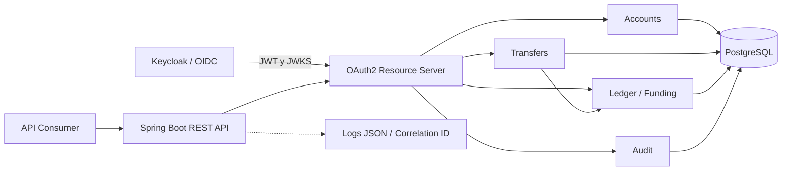

# FinBridge — Enterprise Banking Platform

[](https://github.com/IngenieroJosser/finbridge-banking-platform/actions/workflows/ci.yml)


Backend bancario de referencia para la gestión de cuentas, transferencias internas y registros contables de doble partida. FinBridge aplica principios de ingeniería financiera, consistencia transaccional, seguridad por identidad y propiedad del recurso, auditoría y calidad de software.

El sistema modela las operaciones de NovaBank, una entidad ficticia. Es un proyecto independiente de portafolio e ingeniería de software: no pertenece a GFT ni a una entidad financiera real y no procesa dinero real.

## Estado del proyecto

**Alcance validado:** FB-001 a FB-009, Sprints 1–3. Esquema de persistencia V6.

| Indicador | Evidencia al 24/11/2026 |
| --- | --- |
| Pruebas automatizadas locales | 24 aprobadas, 0 fallos, 0 errores, 0 omitidas |
| Base de datos de integración | PostgreSQL 16 mediante Testcontainers |
| Aceptación E2E | Aprobada con cinco identidades y JWT reales de Keycloak |
| Integración continua | Cinco ejecuciones satisfactorias; última en main, 46 s |
| Migraciones | V1–V6; instalación desde cero y actualización V5 → V6 verificadas |
| Gobierno del repositorio | Ruleset main-quality-gate activo sobre main |
| Alcance implementado | 47 Story Points de 68 planificados |

La evidencia corresponde a las ejecuciones de aceptación del Sprint 3, no a una medición continua de cobertura o rendimiento. El badge de CI refleja el estado actual del workflow.

## Capacidades implementadas

- Apertura y consulta de cuentas COP, con saldo inicial cero.
- Fondeo sintético administrativo mediante asiento balanceado y contrapartida bancaria.
- Transferencias internas entre cuentas del mismo titular autenticado.
- Ledger de doble partida, inmutabilidad de postings y proyección de saldos mediante PostgreSQL.
- Transacciones ACID, prevención de sobregiros y bloqueos en orden determinista.
- Idempotencia persistida por actor, operación y clave, con detección de cambios en el cuerpo de la solicitud.
- Autenticación OAuth2 Resource Server con JWT RS256 y autorización RBAC y ownership.
- Auditoría append-only y reconstrucción de operaciones mediante actor, journal, postings y correlationId.
- Errores HTTP Problem Details (RFC 9457), logging JSON y health checks.
- Pruebas unitarias, MVC, integración, regresión y concurrencia; CI en cada PR a main.

Las transferencias interbancarias, Transactional Outbox, callbacks del proveedor y conciliación permanecen fuera del alcance implementado.

## Arquitectura

FinBridge utiliza un **monolito modular**. La decisión prioriza consistencia ACID, límites explícitos de dominio y simplicidad operativa sin introducir coordinación distribuida prematuramente.



### Garantías financieras

Una transferencia interna confirmada persiste la transferencia, el journal, los postings, la proyección de balances, la idempotencia y el evento de auditoría dentro de una única transacción. Si falla el commit, se revierte la operación completa.

- Los importes se representan con precisión decimal, no con tipos de punto flotante.
- El ledger es la fuente contable y los balances son una proyección.
- Los locks de filas se adquieren antes de validar fondos; se utiliza un orden consistente de identificadores.
- Las restricciones y triggers de PostgreSQL refuerzan la integridad de los asientos y rechazan operaciones inválidas.
- Una clave de idempotencia repetida con el mismo cuerpo devuelve el mismo identificador. Si cambia el cuerpo, responde HTTP 409.
- Los movimientos históricos no se editan; las correcciones contables deben realizarse mediante asientos compensatorios.

### Ejemplo de doble partida

Transferencia interna de 25.000 COP entre dos cuentas del mismo cliente:

| Cuenta | Saldo inicial | Posting | Saldo final |
| --- | ---: | --- | ---: |
| A (origen) | 100.000 | DEBIT 25.000 | 75.000 |
| B (destino) | 0 | CREDIT 25.000 | 25.000 |
| **Total** | **100.000** | **Débitos = créditos** | **100.000** |

La operación y sus reintentos fueron verificados en la prueba E2E con Keycloak y PostgreSQL reales.

## Stack tecnológico

| Capa | Tecnología |
| --- | --- |
| Runtime | Java 21, Maven |
| Backend | Spring Boot 3.5.16, Spring MVC, Bean Validation |
| Persistencia | Spring Data JPA, Hibernate, PostgreSQL 16 |
| Migraciones | Flyway, ddl-auto: validate |
| Identidad | Spring Security OAuth2 Resource Server, JWT RS256, Keycloak 26.4.7 (laboratorio) |
| Observabilidad | Spring Boot Actuator, logs JSON Logstash, MDC |
| Pruebas | JUnit 5, Mockito, MockMvc, Testcontainers |
| Infraestructura local | Docker, Docker Compose |
| CI | GitHub Actions |
| Contrato HTTP | OpenAPI 3.0.3 |

## Estructura del repositorio

```text
.
├── .github/workflows/ci.yml
├── contracts/openapi.yaml
├── docs/
├── fixtures/reconciliation_sample.csv
├── requests/
├── scripts/
│   ├── init-local-idp.py
│   ├── local-token.py
│   └── verify-keycloak-e2e.py
├── src/
│   ├── main/
│   │   ├── java/com/finbridge/paymenthub/
│   │   └── resources/db/migration/
│   └── test/java/
├── .env.example
├── compose.yaml
├── Dockerfile
└── pom.xml
```

## Ejecución local

### Requisitos

Java 21, Maven, Docker con Compose, Python 3, Git y curl. El laboratorio no requiere infraestructura cloud.

```bash
git clone https://github.com/IngenieroJosser/finbridge-banking-platform.git
cd finbridge-banking-platform

# Solo en una instalación nueva; no sobrescribir configuración existente.
test -f .env || cp .env.example .env
```

Configurar una contraseña local de PostgreSQL en `.env` antes de crear el contenedor. Si existe una base previa, conservar sus credenciales y volumen. El ejemplo de entorno contiene los parámetros de conexión, issuer, JWKS y audiencia.

| Servicio | Dirección predeterminada |
| --- | --- |
| API | http://localhost:8080 |
| PostgreSQL | localhost:5433 |
| Keycloak | http://localhost:8180 |
| Issuer | http://localhost:8180/realms/finbridge |
| Audiencia JWT | finbridge-api |

### Infraestructura e identidad

```bash
# Generar el realm únicamente si no existe.
test -f .local-idp/realm.json || python3 scripts/init-local-idp.py

docker compose --profile idp up -d db idp

# Repetir hasta que Keycloak termine de importar el realm.
curl -fsS http://localhost:8180/realms/finbridge/.well-known/openid-configuration
```

El generador crea cinco usuarios sintéticos con contraseñas aleatorias. El directorio `.local-idp/` y el archivo `.env` están excluidos de Git. No regenerar el realm mientras el contenedor conserva las identidades anteriores.

### Backend

```bash
set -a
source .env
set +a

mvn clean verify
mvn spring-boot:run
```

Flyway aplica las migraciones pendientes durante el arranque. No modificar migraciones ya aplicadas ni eliminar volúmenes para resolver incidencias de esquema.

En otra terminal:

```bash
curl -fsS http://localhost:8080/actuator/health
```

Respuesta esperada: `{"status":"UP"}`.

El perfil Docker `full` permite construir y ejecutar también la API dentro de Docker: `docker compose --profile idp --profile full up --build -d`. No ejecutar simultáneamente las dos instancias de la API sobre el mismo puerto.

## API REST

Contrato completo: [contracts/openapi.yaml](contracts/openapi.yaml). La especificación distingue las operaciones disponibles de las previstas en el roadmap.

| Método | Endpoint | Permiso |
| --- | --- | --- |
| GET | /actuator/health | Público |
| POST | /api/v1/accounts | OPERATIONS, ADMIN |
| GET | /api/v1/accounts/{accountId} | Titular o rol autorizado |
| GET | /api/v1/accounts/{accountId}/balance | Titular o rol autorizado |
| POST | /api/v1/admin/accounts/{accountId}/opening-balance | ADMIN; sandbox habilitado |
| POST | /api/v1/transfers | CUSTOMER; ambas cuentas propias |
| GET | /api/v1/transfers/{transferId} | Titular o rol autorizado |
| GET | /api/v1/audit/transfers/{transferId} | AUDITOR, OPERATIONS |

Ejemplo de consulta autenticada (usar el UUID de una cuenta existente del cliente sintético):

```bash
TOKEN=$(python3 scripts/local-token.py customer-a)
ACCOUNT_ID=UUID_DE_CUENTA_PROPIA
curl -fsS "http://localhost:8080/api/v1/accounts/${ACCOUNT_ID}/balance" \
  -H "Authorization: Bearer $TOKEN"
unset TOKEN
```

Las transferencias y el fondeo exigen `Idempotency-Key`. La cabecera opcional `X-Correlation-ID` facilita el seguimiento de cada petición; si se omite, el servidor genera una correlación.

| HTTP | Semántica |
| --- | --- |
| 200 / 201 | Consulta / operación completada |
| 400 | Solicitud inválida |
| 401 | Token ausente o inválido |
| 403 | Rol insuficiente o recurso ajeno |
| 404 | Recurso inexistente |
| 409 | Conflicto de idempotencia |
| 422 | Regla financiera incumplida |

## Seguridad y auditoría

El proveedor de identidad emite los JWT; FinBridge valida firma, issuer, audiencia, expiración y subject. El sujeto autenticado se vincula al identificador del cliente en el laboratorio. La autorización no confía en un ownerId suministrado por el consumidor.

| Operación | CUSTOMER | OPERATIONS | AUDITOR | ADMIN |
| --- | --- | --- | --- | --- |
| Apertura de cuenta | No | Sí | No | Sí |
| Consulta de cuenta y saldo | Propia | Sí | Sí | Sí |
| Transferencia interna | Ambas propias | No | No | No |
| Consulta de transferencia | Ambas propias | Sí | Sí | Sí |
| Fondeo sandbox | No | No | No | Sí |
| Evidencia de auditoría | No | Sí | Sí | No |

Los registros de auditoría confirmada se persisten junto con la operación financiera. Los logs de petición incluyen correlación, plantilla de ruta, método, estado y duración, sin registrar JWT ni cuerpos de solicitud. El endpoint de auditoría reconstruye los asientos y el actor asociado.

**Límites de seguridad:** Keycloak en modo desarrollo, password grant y fondeo sintético son exclusivamente locales. Para entornos reales se requieren un IdP adecuadamente configurado, TLS, gestión de secretos, separación de usuarios PostgreSQL de migración y ejecución, permisos mínimos, retención de auditoría externa y revisión de amenazas. La protección append-only mediante triggers no equivale a almacenamiento WORM ni a cumplimiento regulatorio.

## Pruebas y calidad

```bash
# Docker debe estar disponible.
mvn clean verify
```

| Suite | Pruebas aprobadas |
| --- | ---: |
| FinBridgeSprint1IntegrationTest | 9 |
| FinBridgeSprint2IntegrationTest | 8 |
| FinBridgeSprint3IntegrationTest | 4 |
| LegacyIdempotencyMigrationTest | 1 |
| TransferDomainTest | 2 |
| **Total** | **24** |

Escenarios financieros y de seguridad comprobados: 20 solicitudes concurrentes con una misma clave, dos débitos simultáneos de 80.000 COP sobre un saldo de 100.000 COP (un éxito), transferencias bidireccionales concurrentes, rollback de asientos inválidos, protección IDOR, tokens inválidos, restricciones de roles y migración de idempotencia histórica.

### Aceptación E2E con Keycloak

Con PostgreSQL, Keycloak y la API activos, y `SANDBOX_FUNDING_ENABLED=true` únicamente para el laboratorio:

```bash
python3 scripts/verify-keycloak-e2e.py --confirm-sandbox
```

Resultado de aceptación verificado el 24/11/2026:

```text
E2E SUCCESS — saldos A=75000, B=25000, C=0 COP. Datos sintéticos conservados.
```

El script valida identidad, roles, propiedad, Problem Details, fondeo, transferencia, replay, conflicto de idempotencia, conservación del dinero, actor, correlación y doble partida. Crea cuentas sintéticas nuevas por ejecución y conserva los movimientos.

### Integración continua

El workflow [FinBridge - Maven CI](https://github.com/IngenieroJosser/finbridge-banking-platform/actions/workflows/ci.yml) ejecuta Java 21, verifica Docker, compila y ejecuta `mvn -B --no-transfer-progress clean verify` en pushes y PR dirigidos a main. Los reportes JUnit XML se publican como artefactos. Las pruebas de CI utilizan un fixture JWKS efímero; la prueba con Keycloak real se ejecuta de forma complementaria en el entorno local.

El ruleset de main establece un flujo de integración mediante Pull Request. Mantener las comprobaciones de CI como requisito de integración y preservar la trazabilidad de los cambios.

## Roadmap

| Sprint | Historias | SP | Estado |
| --- | --- | ---: | --- |
| 1 — Fundamentos y persistencia | FB-001 a FB-003 | 13 | Validado |
| 2 — Motor de transferencias | FB-004 a FB-006 | 21 | Validado |
| 3 — Acceso y calidad de servicio | FB-007 a FB-009 | 13 | Validado |
| 4 — Integraciones y resiliencia | FB-010 a FB-013 | 21 | Planificado |

Sprint 4 contempla Transactional Outbox con reserva contable, proveedor externo simulado, retries con backoff y DLQ, callbacks HMAC idempotentes, conciliación CSV y métricas operativas. La recepción HTTP 202 se distinguirá del resultado de liquidación financiera.

## Documentación técnica

| Documento | Contenido |
| --- | --- |
| [01 — Brief de negocio](docs/01-brief-negocio.md) | Contexto, objetivos y restricciones |
| [02 — Reglas y flujos](docs/02-reglas-y-flujos.md) | Invariantes, estados y riesgos |
| [03 — Arquitectura y ADR](docs/03-arquitectura-y-adr.md) | Decisiones de diseño |
| [04 — Modelo de datos](docs/04-modelo-de-datos.md) | Entidades y restricciones |
| [05 — Backlog](docs/05-backlog.md) | Historias y criterios de aceptación |
| [06 — Pruebas de aceptación](docs/06-pruebas-de-aceptacion.md) | Casos de validación |
| [07 — Calidad, seguridad y operación](docs/07-calidad-seguridad-operacion.md) | Quality gates y observabilidad |
| [08 — Evaluación y defensa](docs/08-evaluacion-y-defensa.md) | Revisión de arquitectura |
| [10 — Sprint 1](docs/10-sprint1-implementacion.md) | Persistencia y ledger |
| [11 — Sprint 2](docs/11-sprint2-motor-transferencias.md) | Motor transaccional |
| [12 — Hotfix V5](docs/12-incidente-sprint2-hotfix-v5.md) | Corrección de integridad SQL |
| [13 — Sprint 3](docs/13-sprint3-acceso-calidad.md) | Seguridad y auditoría |
| [14 — E2E y CI](docs/14-validacion-end-to-end-ci.md) | Procedimientos de aceptación |

Las guías de implementación conservan el contexto histórico de cada entrega. El estado de validación consolidado se encuentra en este README.

---

FinBridge es un laboratorio de ingeniería financiera con datos completamente ficticios. No constituye una plataforma bancaria certificada ni está destinado a operar fondos reales.
