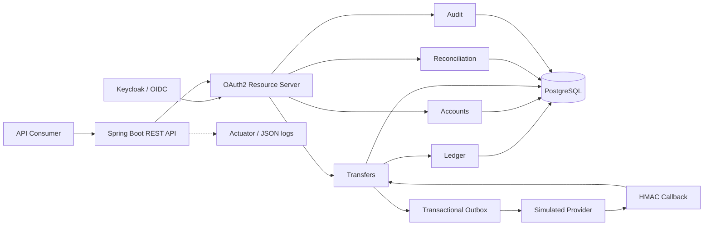

# FinBridge — Enterprise Banking Platform

[](https://github.com/IngenieroJosser/finbridge-banking-platform/actions/workflows/ci.yml)


Backend bancario de referencia para cuentas, transferencias, contabilidad de doble partida e integración asíncrona. Aplica consistencia transaccional, autenticación y autorización por identidad y propiedad, resiliencia, auditoría y conciliación.

NovaBank es una entidad ficticia. FinBridge es un proyecto independiente de ingeniería de software; no pertenece a GFT ni procesa dinero real.

## Estado del proyecto

| Sprint | Historias | SP | Estado |
|---|---|---:|---|
| 1 — Fundamentos y persistencia | FB-001–003 | 13 | Validado |
| 2 — Motor de transferencias | FB-004–006 | 21 | Validado |
| 3 — Acceso y calidad de servicio | FB-007–009 | 13 | Validado |
| 4 — Integraciones y resiliencia | FB-010–013 | 21 | Integración automatizada aprobada; aceptación operativa final pendiente |

Evidencia al 24/11/2026: 34 pruebas automatizadas (24 de regresión y 10 del Sprint 4) aprobadas con PostgreSQL 16 y Flyway V1–V7; ejecución diagnóstica local de 19,497 s con worker deshabilitado. Regresión E2E interna con cinco identidades reales de Keycloak aprobada. Liquidación externa de 10.000 COP verificada mediante API, con saldo de 75.000 a 65.000 COP, dos journals, cuatro postings balanceados y tres eventos correlacionados. Snapshot operativo: una transferencia externa liquidada, cero eventos DLQ y cero asientos desbalanceados.

El PR #4 de aislamiento de pruebas y actualización de acciones CI fue integrado en main (`1b35737`), con `verify` remoto exitoso. La validación local del hotfix con worker habilitado y la aceptación E2E de rechazo, timeout, conciliación y métricas adversas deben quedar registradas antes de publicar v1.0.0. El badge de CI refleja el estado vigente de main.

## Arquitectura

Monolito modular: consistencia ACID y límites de dominio explícitos sin introducir coordinación distribuida prematuramente.



El simulador utiliza un recibo persistente con transacción independiente, en la misma instancia PostgreSQL. No es una conexión a una red interbancaria real. Publicación y callback son al menos una vez; deduplicación durable protege las operaciones financieras.

## Ingeniería financiera

- Cuentas COP, `BigDecimal`, ledger append-only y saldos proyectados por triggers.
- Apertura a saldo cero y fondeo sintético con contrapartida contable.
- Transferencias internas ACID con bloqueos ordenados y claves idempotentes por actor/operación.
- Reserva externa y outbox atómicos; el HTTP 202 no equivale a liquidación.
- Compensación contable ante rechazo definitivo; timeout conserva la reserva y puede llevar a IN_REVIEW.
- Callbacks autenticados mediante HMAC-SHA256, timestamp y deduplicación.
- Conciliación CSV de diferencias sin modificar el ledger; exportación y paginación.
- Auditoría reconstruible mediante actor, correlación, journals y postings.

| Operación externa | Débito | Crédito |
|---|---|---|
| Reserva | Pasivo cliente | Pasivo de compensación |
| Liquidación | Pasivo de compensación | Activo de efectivo |
| Rechazo | Pasivo de compensación | Pasivo cliente |

## Stack

Java 21, Spring Boot 3.5.16, Spring MVC, Bean Validation, Spring Security OAuth2 Resource Server, Spring Data JPA, Hibernate, PostgreSQL 16, Flyway, Keycloak 26.4.7, Micrometer/Actuator, JUnit 5, Mockito, MockMvc, Testcontainers, Docker Compose y GitHub Actions.

## Estructura

```text
.github/workflows/ci.yml
contracts/openapi.yaml
src/main/java/com/finbridge/paymenthub/
  account/       # cuentas y saldos
  transfer/      # transferencias internas
  ledger/        # asientos y fondeo
  integration/   # reservas externas, outbox, proveedor, callbacks y métricas
  reconciliation/# clasificación y exportación de discrepancias
  audit/         # evidencia transaccional
  security/      # JWT, RBAC y ownership
  shared/        # Problem Details, correlación y auditoría
src/main/resources/db/migration/ # V1–V7
src/test/java/
fixtures/
requests/
scripts/
docs/
```

## Ejecución local

Requisitos: Java 21, Maven, Docker Compose, Python 3, Git y curl. No requiere servicios cloud.

```bash
git clone https://github.com/IngenieroJosser/finbridge-banking-platform.git
cd finbridge-banking-platform
test -f .env || cp .env.example .env
```

En instalaciones nuevas, sustituir la contraseña de ejemplo de PostgreSQL en `.env`. En instalaciones existentes conservar credenciales y volumen. Para la integración externa local, generar un secreto de 32 bytes o más (`openssl rand -hex 32`) y asignar en `.env`:

```dotenv
PROVIDER_HMAC_SECRET=VALOR_GENERADO_LOCALMENTE
PROVIDER_WORKER_ENABLED=true
SANDBOX_FUNDING_ENABLED=true
```

El fondeo y el proveedor son exclusivamente de laboratorio. Los secretos y `.local-idp/` no se versionan.

```bash
test -f .local-idp/realm.json || python3 scripts/init-local-idp.py
docker compose --profile idp up -d db idp
curl -fsS http://localhost:8180/realms/finbridge/.well-known/openid-configuration
# Repetir discovery si Keycloak aún arranca.
set -a; source .env; set +a
mvn clean verify
mvn spring-boot:run
```

| Servicio | Dirección predeterminada |
|---|---|
| API | http://localhost:8080 |
| PostgreSQL | localhost:5433 |
| Keycloak | http://localhost:8180 |
| Issuer | http://localhost:8180/realms/finbridge |
| Audiencia | finbridge-api |

Health check: `curl -fsS http://localhost:8080/actuator/health`. Flyway aplica V7 al arrancar. No editar migraciones aplicadas ni eliminar los volúmenes existentes para resolver errores. El perfil `full` permite ejecutar la API dentro de Docker en lugar de Maven: `docker compose --profile idp --profile full up --build -d`.

## API y seguridad

Contrato [OpenAPI 3.0.3](contracts/openapi.yaml). Las rutas de movimientos paginados de cuenta siguen fuera del alcance actual.

| Método | Endpoint | Permiso |
|---|---|---|
| GET | /actuator/health | Público |
| POST | /api/v1/accounts | OPERATIONS, ADMIN |
| GET | /api/v1/accounts/{id} y /balance | Titular o rol de consulta |
| POST | /api/v1/admin/accounts/{id}/opening-balance | ADMIN, opt-in sandbox |
| POST | /api/v1/transfers | CUSTOMER, ambas cuentas propias |
| GET | /api/v1/transfers/{id} | Titular o rol de consulta |
| POST | /api/v1/external-transfers | CUSTOMER, origen propio |
| GET | /api/v1/external-transfers/{id} | Titular o rol de consulta |
| POST | /api/v1/provider/events | HMAC, no JWT |
| GET | /api/v1/audit/transfers/{id} | AUDITOR, OPERATIONS |
| POST | /api/v1/reconciliations/import | OPERATIONS |
| GET | /api/v1/reconciliations/{id}, /items, /export | AUDITOR, OPERATIONS |
| GET | /actuator/metrics y /{name} | AUDITOR, OPERATIONS |

Las operaciones monetarias requieren `Idempotency-Key`. Los errores usan Problem Details RFC 9457: 400 solicitud inválida, 401 autenticación, 403 autorización, 404 recurso inexistente, 409 conflicto, 422 regla financiera y 503 integración no configurada.

```bash
TOKEN=$(python3 scripts/local-token.py customer-a)
# Reemplazar ACCOUNT_ID con UUID de una cuenta propia y fondeada.
ACCOUNT_ID=UUID_DE_CUENTA_PROPIA
curl -fsS -X POST http://localhost:8080/api/v1/external-transfers \
  -H "Authorization: Bearer $TOKEN" -H "Idempotency-Key: $(uuidgen)" \
  -H 'Content-Type: application/json' \
  -d "{\"sourceAccountId\":\"$ACCOUNT_ID\",\"providerBankCode\":\"SANDBOX_BANK\",\"destinationAccountReference\":\"SYNTH-1234\",\"amount\":25000,\"currency\":\"COP\"}"
unset TOKEN
```

Los escenarios sintéticos SANDBOX_BANK, SANDBOX_REJECT y SANDBOX_TIMEOUT permiten verificar liquidación, devolución e incertidumbre. Un replay conserva el ID; la consulta devuelve el estado vigente. Ver [guía V7](docs/15-sprint4-integraciones-resiliencia.md).

## Calidad, CI y observabilidad

```bash
mvn clean verify
# Con API y Keycloak activos; solo datos sintéticos:
python3 scripts/verify-keycloak-e2e.py --confirm-sandbox
python3 scripts/verify-sprint4-e2e.py --confirm-sandbox
python3 scripts/metrics-snapshot.py
```

Las pruebas de regresión anteriores cubren 20 reintentos concurrentes, sobregiro, transferencias bidireccionales, rollback, JWT y ownership. La suite Sprint 4 incorpora AT-13 a AT-18, crash-after-publish, callbacks duplicados y tardíos, compensación, DLQ, fixture de conciliación y métricas. El dashboard de snapshot se genera con valores observados en `target/metrics-snapshot.html`; no inventa benchmarks.

El workflow [FinBridge - Maven CI](https://github.com/IngenieroJosser/finbridge-banking-platform/actions/workflows/ci.yml) comprueba Docker, ejecuta Maven verify y publica reportes JUnit. La integración se realiza por PR. Las pruebas JWT usan un fixture JWKS real efímero; el E2E Keycloak es un gate local complementario. Las pruebas V7 están aprobadas; el script de aceptación externa verifica la ejecución del worker real del sandbox y conserva la evidencia local por ejecución. Consultar [cierre y release](docs/16-aceptacion-release.md).

## Documentación técnica

| Documento | Contenido |
|---|---|
| [01 — Brief](docs/01-brief-negocio.md) | Negocio y restricciones |
| [02 — Reglas y flujos](docs/02-reglas-y-flujos.md) | Invariantes y estados |
| [03 — Arquitectura](docs/03-arquitectura-y-adr.md) | ADR de referencia |
| [04 — Modelo](docs/04-modelo-de-datos.md) | Entidades y restricciones |
| [05 — Backlog](docs/05-backlog.md) | Historias y aceptación |
| [06 — Pruebas](docs/06-pruebas-de-aceptacion.md) | AT-01–18 |
| [07 — Calidad](docs/07-calidad-seguridad-operacion.md) | Seguridad y operación |
| [08 — Evaluación](docs/08-evaluacion-y-defensa.md) | Code review |
| [10 — Sprint 1](docs/10-sprint1-implementacion.md) | Ledger |
| [11 — Sprint 2](docs/11-sprint2-motor-transferencias.md) | Transferencias ACID |
| [12 — Hotfix V5](docs/12-incidente-sprint2-hotfix-v5.md) | Corrección SQL |
| [13 — Sprint 3](docs/13-sprint3-acceso-calidad.md) | JWT y auditoría |
| [14 — E2E y CI](docs/14-validacion-end-to-end-ci.md) | Evidencias y procedimientos |
| [15 — Sprint 4](docs/15-sprint4-integraciones-resiliencia.md) | Contabilidad externa, resiliencia y conciliación |
| [16 — Aceptación y release](docs/16-aceptacion-release.md) | Validación reproducible y criterios de publicación |

## Límites

Proyecto exclusivamente sintético. El modo desarrollo de Keycloak, password grant local, fondeo administrativo, simulador en misma BD y conciliación acotada no constituyen un sistema productivo. La evolución requiere proveedor real, TLS, rotación de secretos, roles de BD separados, control de acceso, redrive operativo, retención externa de auditoría, pruebas de carga y revisión de cumplimiento. Append-only mediante triggers no equivale a WORM.
