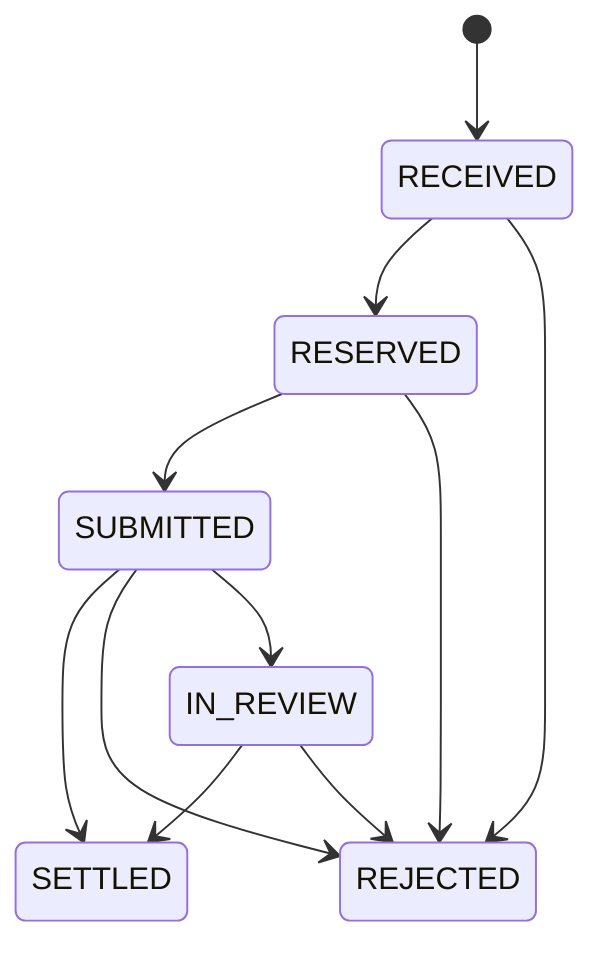

# 02 | Reglas financieras, consistencia e integración

## Reglas de cuenta

- Estado `ACTIVE`, `BLOCKED`, `CLOSED`. Solo `ACTIVE` puede emitir o recibir fondos en el MVP.
- Propietario asociado a `owner_id`; en la API segura, un titular no puede operar cuentas ajenas.
- Cuenta origen y destino deben existir, ser distintas y usar `COP`.
- `available_balance` nunca puede quedar negativo. Nunca uses `float`/`double` para dinero.
- La carga inicial (opening funding) debe justificarse con una contraparte contable, igual que una transferencia.

## Transferencia interna

Solicitud `POST /api/v1/transfers` con `Idempotency-Key` UUID o token opaco de 16-128 caracteres. Cuerpo: `sourceAccountId`, `destinationAccountId`, `amount`, `currency`, `reference`.

### Éxito: todo o nada

1. Validar autorización, cuentas, estados, moneda, monto y clave.
2. Determinar si la clave ya fue procesada por el mismo actor y operación.
3. Adquirir bloqueos de saldo **en orden determinista** de ID para mitigar deadlocks.
4. Validar disponible bajo bloqueo.
5. Persistir transferencia y un journal contable con exactamente dos postings balanceados.
6. Actualizar la proyección de saldos y guardar registro de idempotencia en **la misma transacción**.
7. Confirmar y responder `201` con estado `COMPLETED` y URI del recurso.

**Convención contable:** para depósitos del cliente tratados como pasivo del banco, un `DEBIT` a la cuenta origen reduce su saldo acreedor y un `CREDIT` a destino aumenta su saldo acreedor. Siempre `SUM(debit)=SUM(credit)` dentro de un `journal`, misma moneda. Documenta de forma explícita esta convención y cómo se corresponde con el `available_balance` materializado.

### Idempotencia

- Mismo actor + endpoint/operación + clave + mismo cuerpo canónico => misma operación original, sin crear otro asiento. Respuesta semánticamente equivalente, con mismo `transferId`.
- Mismo ámbito + misma clave + cuerpo diferente => `409 Conflict`.
- Distintas claves => peticiones distintas, sujetas a fondos.
- El sistema debe gestionar la carrera entre dos peticiones simultáneas de igual clave con una restricción única de base de datos, no solo `if` de memoria.
- Guarda un hash estable del cuerpo normalizado y define la política de retención de claves (para el ejercicio: sin expiración automática).

### Concurrencia

Saldo origen = 100.000,00; dos solicitudes simultáneas de 80.000,00 con claves distintas: exactamente una puede completar, la otra falla por saldo insuficiente. Saldo final origen = 20.000,00, total conservado.

## Estados de transferencia

**Interna:** `RECEIVED -> COMPLETED` o `RECEIVED -> REJECTED`.

**Externa (Sprint 4):**

- Nunca declares `SETTLED` por un `HTTP 202 Accepted` del proveedor; indica recepción, no liquidación.
- Ante `timeout`, no asumas fracaso: el proveedor quizá ejecutó la operación.
- Una reversión después de reserva se ejecuta mediante un movimiento compensatorio **idempotente**.
- Webhook duplicado o fuera de orden no puede crear dos movimientos ni retroceder de `SETTLED` a `SUBMITTED`.
- Estados desconocidos quedan pendientes de investigación; no se pierden silenciosamente.

## Patrón Outbox

Dentro de la misma transacción que cambia el agregado persiste un evento `TransferRequested`. Un publicador lo envía posteriormente. Si cae después de publicar y antes de marcar entregado, la publicación puede repetirse: la semántica práctica es **at-least-once**. Los consumidores deben deduplicar por identificador de evento. Evita prometer `exactly-once` de punta a punta.

## Compensación y conciliación

El proveedor externo usa su propio identificador. La conciliación compara `internalTransferId/providerTransferId/amount/currency/status`. Identifica: `MATCHED`, `MISSING_IN_BANK`, `MISSING_IN_PROVIDER`, `AMOUNT_MISMATCH`, `STATUS_MISMATCH`, `DUPLICATE_PROVIDER_ENTRY`. No ajustes saldos automáticamente al importar un archivo: genera una incidencia para revisión operativa.
