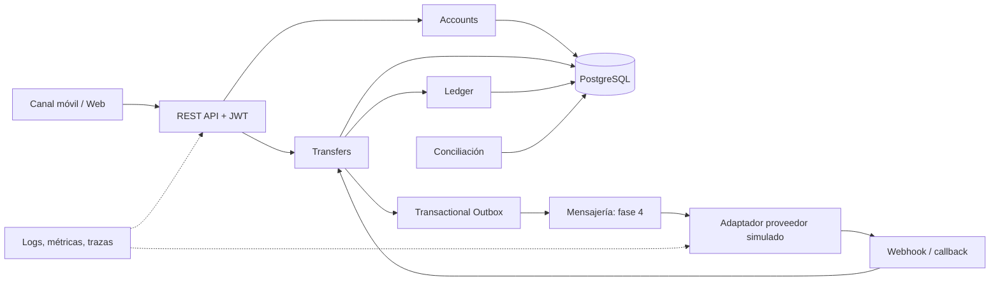

# 03 | Arquitectura propuesta y decisiones

## Decisión 001: monolito modular primero



Para este reto, un **monolito modular** ofrece transacciones ACID entre cuenta, transferencia y ledger, menor costo operativo, depuración sencilla y límites de dominio explícitos. Si se separan servicios prematuramente, aparecen coordinación distribuida, mayor latencia, consistencia eventual y más superficies de fallo.

### Módulos sugeridos

```text
src/main/java/com/finbridge/paymenthub/
  account/
    api/           # controllers y DTOs
    application/   # casos de uso y orquestación
    domain/        # invariantes y modelos de negocio
    infrastructure/# JPA, SQL y adaptadores
  transfer/
    api/
    application/
    domain/
    infrastructure/
  ledger/
    application/
    domain/
    infrastructure/
  integration/     # proveedor, outbox, callbacks (fase posterior)
  reconciliation/  # batch e informes (fase posterior)
  security/        # resource server, políticas, claims (fase posterior)
  shared/          # errores RFC 9457, correlación, reloj
```

**Regla:** la capa de dominio no conoce Spring MVC ni `ResponseEntity`. No expongas entidades JPA directamente por HTTP. El acoplamiento entre módulos debe estar justificado, no mediante acceso libre a repositorios ajenos.

## Decisión 002: consistencia transaccional

Para transferencias internas, `transfer + journal + postings + balances + idempotency` pertenecen a una transacción de base de datos. La validación de saldo ocurre después de adquirir el bloqueo. Usa bloqueos pesimistas sobre filas relevantes o aislamiento equivalente probado; no basta `@Transactional` por sí solo para evitar carreras.

## Decisión 003: ledger inmutable

El registro de asientos es la fuente auditada. El saldo disponible puede estar materializado para rendimiento, pero se comprueba contra los movimientos. No edites postings históricos. Corrige con asientos compensatorios.

## Decisión 004: estados externos y reintentos

La integración con terceros será asíncrona con outbox, identificadores propios, timeouts, backoff acotado, DLQ y consumidores idempotentes. Separar resultado de transporte (`HTTP 202`) de resultado financiero (`SETTLED`).

## Decisión 005: seguridad

El sistema es Resource Server: valida JWT de un IdP externo; no implementes autenticación casera ni guardes contraseñas en el dominio. Autoriza por rol **y propiedad de cuenta**; protege callbacks mediante firma, timestamp y replay prevention. Mantén secretos fuera de Git.

## Decisión 006: cloud como evolución, no requisito MVP

Empieza local. Si luego quieres desplegar en Azure, una ruta viable es Azure Container Apps + Azure Database for PostgreSQL + Key Vault + Monitor/Application Insights y mensajería gestionada. Antes de hacerlo realiza estimación de costos, alertas presupuestarias, networking y evaluación de alternativas. Para este entrenamiento no necesitas contratar recursos cloud.

## Riesgos de diseño que debes defender

- Falla entre persistencia y envío al proveedor.
- Dos peticiones simultáneas con la misma clave de idempotencia.
- Contención de bloqueos y deadlocks cuando A envía a B y B envía a A.
- Lecturas de saldo materializado inconsistente con ledger.
- Webhooks auténticos pero atrasados; duplicados o reordenados.
- Exposición de cuentas por IDOR: usuario accede a UUID ajeno.
- Log de información sensible.
