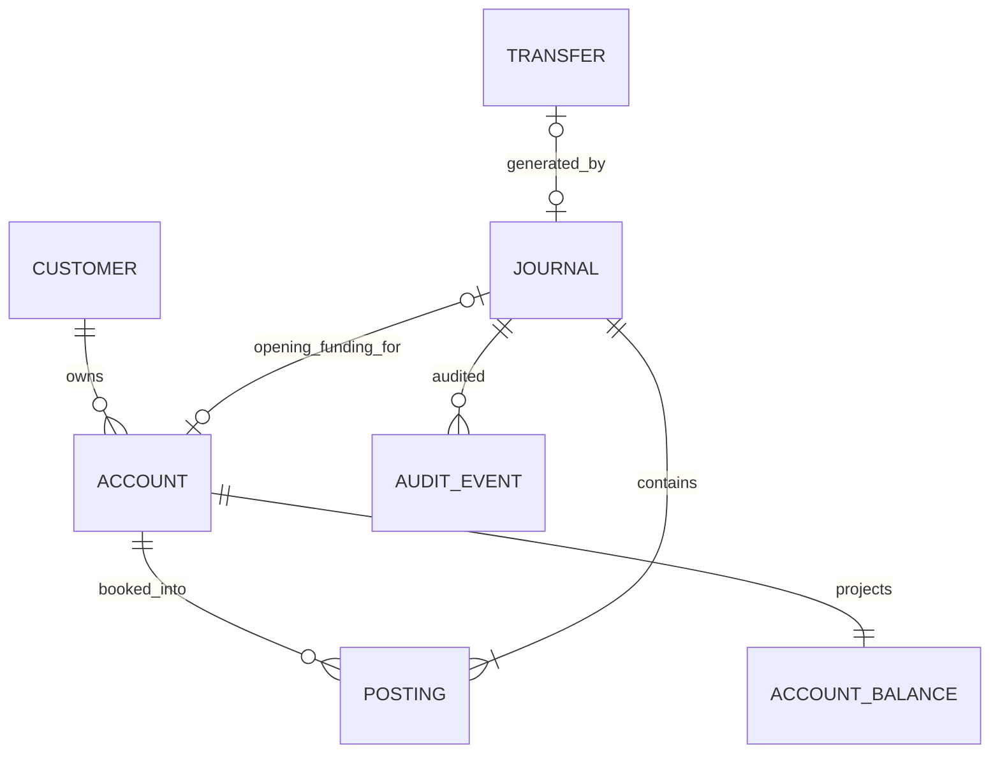

# Sprint 1 | Implementación de referencia — FB-001, FB-002 y FB-003

> Caso ficticio de ingeniería bancaria. **No procesar fondos reales.** Sin JWT ni ownership de cuentas hasta el Sprint 3. Los endpoints públicos de cuentas carecen aún de autorización empresarial. **El fondeo administrativo está deshabilitado por defecto** y exige habilitar el sandbox y un token local; ese token no sustituye un IdP ni RBAC.

## FB-001 — Diseño financiero

Se mantienen `V1__baseline.sql` y su checksum **sin cambios**. `V2__banking_schema.sql` crea el esquema de dominio y sus controles; `V3__sandbox_reference_data.sql` añade datos sintéticos para facilitar un flujo de ejemplo reproducible. **No ejecutar V3 como datos maestros en producción.**

### Entidades y relaciones



> `audit_event.aggregate_id` es un identificador lógico polimórfico, no FK física al journal. El ERD es esquemático; revisar el DDL para cardinalidades y restricciones exactas.

**Decisión contable:** los depósitos del titular se modelan como `CUSTOMER_LIABILITY` (pasivo del banco). Un `CREDIT` al cliente aumenta `available_amount`, y un `DEBIT` lo disminuye. La cuenta técnica `BANK_ASSET` representa el activo de contrapartida: un `DEBIT` aumenta su saldo. Así, un fondeo inicial de 100.000 COP queda registrado como:

| Cuenta | Tipo | Debe | Haber | Cambio en saldo proyectado |
|---|---|---:|---:|---:|
| Banco clearing sandbox | `BANK_ASSET` | 100.000 | 0 | +100.000 |
| Cuenta cliente | `CUSTOMER_LIABILITY` | 0 | 100.000 | +100.000 |
| **Total** | | **100.000** | **100.000** | |

El activo bancario representa una posición **sintética de entrenamiento**, no dinero recibido en una cuenta real. Un fondeo real tendría que incorporar custodia, conciliación con depósitos efectivos y validaciones de negocio adicionales.

### Garantías técnicas en PostgreSQL

- UUID como PK, `FOREIGN KEY` para integridad referencial y `UNIQUE` para referencias e idempotencia.
- `NUMERIC(19,2)` para cantidades; nada de `double` ni `float`.
- `CHECK` para COP, estado, no negatividad e importes positivos.
- `trg_apply_posting`: un `INSERT posting` actualiza el saldo materializado mediante la convención de signo según tipo de cuenta, dentro de la misma transacción. Por tanto, el servicio **no hace `UPDATE account_balance`**.
- `trg_guard_balance` rechaza actualizaciones directas de la proyección. Esta medida basada en `pg_trigger_depth` es un control de aplicación/sandbox: en producción se complementa con **roles y GRANTs de mínimo privilegio** y propietario de funciones separado.
- `trg_guard_posting` bloquea la fila de journal antes de agregar postings y prohíbe insertar después de `POSTED`.
- `ck_posted_journal` y `ck_balanced_postings` son *constraint triggers diferidos al commit*: aseguran al menos dos postings, suma de débitos igual a créditos y un journal publicado. Las FKs compuestas evitan mezcla de moneda con cuentas o journal.
- `posting` y `audit_event` son append-only. `journal` solo permite transición `DRAFT → POSTED`; no se borra ni altera después.
- Índices sobre cuenta/fecha para movimientos, auditoría por agregado, idempotencia por clave compuesta, y un índice único parcial para asegurar **solo un opening funding por cuenta**.
- `spring.jpa.hibernate.ddl-auto=validate`, no `update`: Flyway es dueño del esquema.

**Límite explícito:** los triggers diferidos garantizan journals válidos en las rutas SQL previstas; quedan pendientes pruebas de privilegios DBA, particionado, bloqueo de `TRUNCATE`, hardening de roles y carga de alto volumen. Una función SECURITY DEFINER y roles separados serían necesarios en despliegues de mayor confianza.

## FB-002 — Apertura y consulta

`POST /api/v1/accounts` recibe `customerId` existente (clientes ficticios en V3) y `currency: COP`. Devuelve `201`, `Location` y DTO. Se crea cuenta `ACTIVE` + proyección `0.00` + evento auditable dentro de una única transacción. `GET /api/v1/accounts/{id}/balance` devuelve `200`; `404` si no existe; `400` para payload inválido o divisa diferente. Nunca se serializan `Entity` de JPA.

IDs sintéticos para probar apertura:

- Cliente A `00000000-0000-4000-8000-000000000011`
- Cliente B `00000000-0000-4000-8000-000000000012`
- Cuenta de contrapartida `00000000-0000-4000-8000-000000000002`

### Ejemplo de apertura

```bash
curl -i -X POST http://localhost:8080/api/v1/accounts \
  -H 'Content-Type: application/json' \
  -d '{"customerId":"00000000-0000-4000-8000-000000000011","currency":"COP"}'
```

Guarda el `id` que retorne y luego ejecuta:

```bash
curl http://localhost:8080/api/v1/accounts/REEMPLAZA_ID/balance
```

## FB-003 — Fondeo de apertura con idempotencia

El controller se carga **solo** con `SANDBOX_FUNDING_ENABLED=true`. Además, compara en tiempo constante `X-Sandbox-Admin-Token` contra la variable `SANDBOX_ADMIN_TOKEN`, que no debe almacenarse en Git. Es una barrera de laboratorio, **no reemplaza autenticación ni autorización**. Para probar:

```bash
# En terminal 1 (en la carpeta del proyecto):
cp .env.example .env  # solo si aún no existe
# Edita .env para incluir:
# SANDBOX_FUNDING_ENABLED=true
# SANDBOX_ADMIN_TOKEN=<salida de openssl rand -hex 32>
set -a; source .env; set +a
mvn spring-boot:run
```

```bash
# En terminal 2, reemplaza las variables por valores reales locales:
export ACCOUNT_ID='UUID_DEVUELTO_POR_POST_ACCOUNTS'
export SANDBOX_ADMIN_TOKEN='EL_TOKEN_GENERADO_EN_TERMINAL_1'
curl -i -X POST "http://localhost:8080/api/v1/admin/accounts/${ACCOUNT_ID}/opening-balance" \
  -H 'Content-Type: application/json' \
  -H "X-Sandbox-Admin-Token: ${SANDBOX_ADMIN_TOKEN}" \
  -H "Idempotency-Key: opening-$(uuidgen)" \
  -H 'X-Correlation-ID: s1-local-test-001' \
  -d '{"amount":100000.00,"reason":"Fondeo inicial de prueba sin fondos reales"}'
```

Para probar reintentos, usa **la misma** `Idempotency-Key` y el mismo JSON; recibirás el mismo `journalId` y no se registrará otro asiento. Con la misma clave y un cuerpo diferente responde `409`. Con una clave nueva y una cuenta ya fondeada también responde `409`. Valida el saldo posterior con `GET /balance`.

### Garantía ante carreras

1. Validación de monto y clave.
2. `pg_advisory_xact_lock` por actor + operación + clave (serializa reintentos concurrentes); PK SQL sigue imponiendo la unicidad durable.
3. Búsqueda de hash canónico SHA-256 para replay seguro (misma clave/cuerpo), `409` si cambia.
4. Lectura de cuentas y adquisición de locks pesimistas de balances en **orden UUID determinista**.
5. Journal DRAFT, débito a activo del banco, crédito a pasivo cliente, cambio a POSTED, idempotencia y auditoría: **una sola transacción ACID**.
6. El trigger diferido valida al commit; cualquier error revierte **todo**, incluyendo proyecciones de balance.

No hay expiración automática de las claves del ejercicio. El hash es de la solicitud normalizada (`accountId|amount|COP|reason`); normaliza escala a dos decimales y espacios extremos en razón. Para una API pública, formalizar un esquema de canonicalización versionado y validarlo contra cambios de contrato.

## Consultas contables de auditoría

```sql
-- Totales por journal: siempre deben ser iguales.
SELECT j.id, j.status,
       count(p.id) AS postings,
       sum(p.amount) FILTER (WHERE p.side='DEBIT') AS debit_total,
       sum(p.amount) FILTER (WHERE p.side='CREDIT') AS credit_total
FROM journal j JOIN posting p ON p.journal_id=j.id
GROUP BY j.id, j.status ORDER BY j.id;

-- Balance reconstruido desde ledger para un pasivo de cliente.
SELECT a.id,
       b.available_amount AS materialized_balance,
       coalesce(sum(CASE WHEN p.side='CREDIT' THEN p.amount ELSE -p.amount END), 0)
           AS ledger_balance
FROM account a
JOIN account_balance b ON b.account_id=a.id
LEFT JOIN posting p ON p.account_id=a.id
WHERE a.account_type='CUSTOMER_LIABILITY'
GROUP BY a.id,b.available_amount;
```

## Pruebas y definición de terminado

```bash
docker info              # Docker Desktop en ejecución
mvn clean verify         # inicia un contenedor PostgreSQL 16 con Testcontainers
```

`FinBridgeSprint1IntegrationTest` ejecuta migraciones reales Flyway, valida entidades con `ddl-auto: validate`, prueba 201/200/404/400, fondeo balanceado, auditoría, replay, 409, token de sandbox ausente, rollback de journal incompleto, inmutabilidad y carreras concurrentes. **No sustituir Testcontainers por H2.**

### Alcance y estado de verificación

- Código y pruebas escritos: FB-001/002/003.
- **El entorno de generación no dispone de Maven ni Docker**, por tanto la ejecución de `mvn clean verify` y las pruebas PostgreSQL **debe realizarse en tu Mac** antes de considerar cerradas las historias.
- AT-01 a AT-10 son tests del **Sprint 2**, todavía pendientes; no declararlos aprobados.
- FB-009 (JWT, validación de propiedad y rol administrador real) queda pendiente. Hasta entonces no exponer la API fuera de un sandbox local controlado.

### Plan de migraciones

En cualquier entorno donde V1 ya fue aplicada, Flyway añade V2 y luego V3 sin editar V1. **No hacer rollback destructivo** de journals. Ante un DDL erróneo aplicado, documentar incidente y generar `V4__...` de forward-fix, validado previamente en entorno clonado; un rollback de datos financieros requiere plan específico y auditoría.
